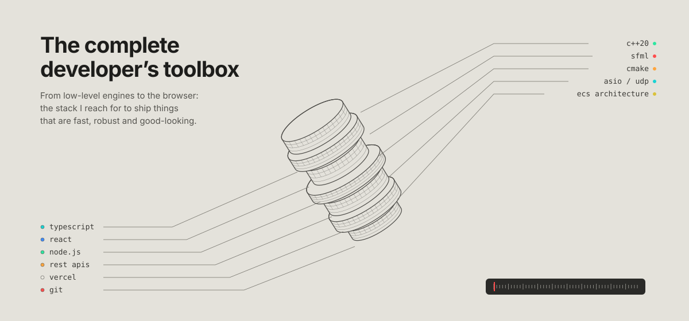
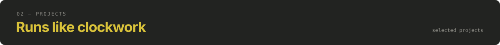
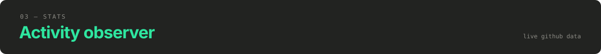
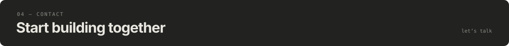

<!-- ───────────────────────────────────────────────────────────
     Sotinkon · profile README
     Animated SVGs live in ./assets — keep that folder next to this file.
     ─────────────────────────────────────────────────────────── -->

<p align="center">
  
</p>

<p align="center">
  
  
  
  
  
  
</p>

<p align="center">
  <a href="https://github.com/Sotinkon"></a>
  <a href="https://github.com/Sotinkon?tab=followers"></a>
</p>


<p align="center">
  
</p>

```cpp
struct Sotinkon {
    std::string_view based_in   = "Cotonou, Benin";
    std::string_view school     = "Epitech";
    std::array<std::string_view, 2> focus = { "real-time C++ engines", "full-stack web apps" };
    std::string_view motto      = "if it can't run at 60 fps, it isn't done yet";
};
```



<table>
  <tr>
    <td width="50%" valign="top">
      <!-- 👉 replace the href with your R-Type repo URL -->
      <a href="https://github.com/Sotinkon?tab=repositories">
        
      </a>
      <p>
        <b>R-Type</b> — a networked remake of the classic shoot'em up: custom game engine,
        client/server architecture over UDP, written in modern C++20 with SFML.
      </p>
    </td>
    <td width="50%" valign="top">
      <!-- 👉 replace the href with your Vercel URL or repo URL -->
      <a href="https://github.com/Sotinkon?tab=repositories">
        
      </a>
      <p>
        <b>Dashboard</b> — a full-stack dashboard, from API to UI,
        deployed and live on Vercel.
      </p>
    </td>
  </tr>
</table>



<p align="center">
  
  
</p>

<p align="center">
  
</p>

<p align="center">
  
</p>



<p align="center">
  <a href="https://github.com/Sotinkon"></a>
  <!-- 👉 uncomment and fill in the ones you want to show
  <a href="https://www.linkedin.com/in/YOUR-ID"></a>
  <a href="mailto:YOUR@EMAIL"></a>
  <a href="https://YOUR-PORTFOLIO"></a>
  -->
</p>


<p align="center"><sub>Designed with care · animated SVG, no JavaScript · © Sotinkon</sub></p>
